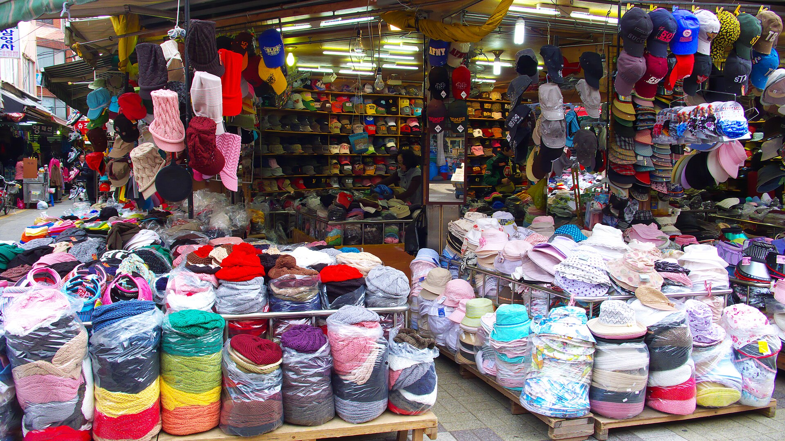

[{fig-alt="Photo of a storefront filled with hats of many styles and colors"}](https://commons.wikimedia.org/wiki/File:2008-03-18_hat_shop_in_Busan.jpg)

I often use a hat store analogy when teaching about Markov Chain Monte Carlo. This is an algorithm most often used in Bayesian inference. 

# Background

Basically, the goal of Bayesian analysis is to calculate the probability of a hypothesis being true given the data. The formula for this is:

**Prob(Hypothesis | Data) = Prob(Data | Hypothesis) * Prob(Hypothesis) / Prob(Data)**

* The **Prob(Data | Hypothesis)** is just the likelihood: how probable the observed data are given our hypothesis (for example, if we flip a coin and get two heads and a tail, and our hypothesis is that the coin gets heads 60% of the time, the probability of seeing this result is 0.6 * 0.6 * 0.4).
* The **Prob(Hypothesis)** is our guesstimate of the chance that our hypothesis is true before looking at the data[^empirical]. For example, we might think that there's a 20% chance that the coin has a probability of heads greater than half, but all values from >50% to 100% chance of heads have the same probability of being the true value for the coin. This is both the beauty and the bane of Bayesian analysis -- it's nice to be able to bring in prior knowledge (for example, we know coins tend to be fair), but it also means the potentially mistaken beliefs we bring to the analysis can affect the results.
* The **Prob(Data)** is the probability of the data integrating over **all** possible hypotheses. What's the chance of getting 2/3 heads on three flips if the coin has a probablity of heads of 0.1 or 0.2 or 0.3523223 or...?

This last part is a practical problem. For coin flipping, our hypothesis is just one parameter, so we can think of clever ways to do integration. But for a lot of problems, there are many parameters, all interacting. And in some problems, like in phylogenetics, some of the parameters are discrete: we have to integrate over the chance of the data evolving on topology 1, or topology 2, or topology 3, or... (and the number of topologies grows double factorially with the number of species on the tree -- for even a small tree there are more possible distinct topologies than atoms in the universe. Exponential growth seems slow relative to double factorial growth!!). 

The brilliant solution to this: **Markov Chain Monte Carlo** (see more of its development [here](https://en.wikipedia.org/wiki/Markov_chain_Monte_Carlo#History)), also known as **MCMC**. 

* "Markov Chain": A bunch of steps where each one cares only about the previous step, forgetting all the previous ones (I'm a bit forgetful; some students call me "Dr. Markov" as a consequence). You could revisit the same parameter values multiple times and don't keep track of parameters you have or haven't sampled.
* "Monte Carlo": basically, "do it Vegas-style" for fancy mathematicians and physicists (the [Monte Carlo Casino](https://en.wikipedia.org/wiki/Monte_Carlo_Casino) is famous) -- do a bunch of random stuff. 

So we just randomly wander around parameter space, trying random values, and only comparing our next possible step to our current position.

In the most common approach (Metropolis-Hastings), we pick a set of parameter values, and calculate the product of the probability of the data given those values (the likelihood, P(D|H)) and the prior probability of those particular values (the prior, P(H)). We write down the product and parameter values we tried (and often the likelihood and prior probability for those values, though all we really need is the product). We then try a new set of parameter values and calculate the product of the likelihood and prior for those values. If the new product is higher, great, we write the new product and parameters down, walk over to that position, and use that as the basis for our next step. If it's worse, we see how much worse and compare the ratio of the new product and the old product to a random number between zero and one; if the ratio is bigger, we take the step anyway; if it's lower, we stay where we were and write down those numbers again.[^hastings]

The amazing thing about this approach is that, by recording the values we've been at, if we do this procedure long enough, the amount of time we spend at each parameter value is proportional to its posterior probability (the P(H|D) above). But this can go wrong in various ways, which we can get a feel for from the hat store analogy:

# Hat Store

🧢 👑 👒 🎩 🪖 🎓 

The analogy I've used in teaching (for nearly 20 years now? ugh) is trying to figure out what kinds of hats you like. So you go into a hat store and put on a hat. Then, you wander around looking at hats one at a time. If you like a hat better than the current one, you put it on your head and put the other one down. If you like it worse, you compare how much worse it is to a random number: if it's not worse than that, you put it on; otherwise you put it down and pick up another hat at random. In the meantime, a security camera takes a photo of you every so often and records the properties of the hat you're wearing: kind of hat, color, propeller count, etc.

This is basically an MCMC process, but for your hat preferences rather than for posterior probabilities for an evolutionary model. But it can illustrate some of the issues.

* If it all goes well, the fraction of the time you have hats with a certain property on your head is proportional to how much you like the hats. If you have a brown hat 40% of the time and a pink hat 10% of the time, your overall preference for brown is 40% out of all possible colors, and you like brown four times as much as you like pink. One can also pick up on correlations: you like brown hats in all styles but only like pink hats if they're cowboy hats with sparkles. 

* When you first walk into the store, the only hats you try on are those near the entrance. That might not reflect your preference: the ones at the front might all be varieties for the local sportsball team and you simply hate those. But they're the only ones you can try at first, so you put them on. If we stopped the camera at that point, we would incorrectly think those are what you like. We have to wait until you've had time to wander around the store a bit to find the really awesome hats at the back. The photos we take where you're only looking at hats because they are near where you came in are the **burnin**: we typically discard them. (And yes, you might be asking, "how do I tell when I'm far enough in?" That's a good question, and there are various approaches and rules of thumb for checking. Basically, you want to be in a place where the hats you put on still vary in how much you like them but there's no longer an improvement trend).

* If you have an identical twin with the same preferences, you could start them in a separate part of the store and have the camera track each of you, keeping track of who is who (wear different shirts that day). At first the distribution of hats you choose are very different, accidents of where you started, but after a while the hats you and your twin have been wearing on average converge. This is known as running **multiple chains**. If only one of you could try a hat at a time, and the other has to wait (maybe you're embarassed about your hair and only one of you can go into the changing room at a time), then this would double the amount of time required; if you can try on hats in parallel, then the time required doesn't really increase. This is the same as running a process on one core or two cores (parallel processing).

* You could get stuck: you could be in a pretty good display of cowboy hats but be separated from the really great propeller hats by racks of detested sportsball caps. Eventually you might wander over there, but it'll require a lot of improbable choosing of bad hats to traverse the distance. But what you could do is get your identical twin a bit... uninhibited and send them to giddily wander the store. They still have your same preferences, but are more willing to put on bad hats. Eventually, they might get to the great part of the store and shout to you, "You HAVE to try these -- they have propellers and lights!" This is running a **heated chain**. The camera still focuses just on you (since we care about what you prefer when sober) but the heated chain helps cross valleys with bad parameter values. There are often multiple heated chains, with different amounts of heating, but we just focus on the regular, "cold" chain.

* How often should the camera take your picture? It feels natural to say "once for every hat" but hats are clumped: the hat nearest to the one you just put on your head is probably similar to it in many ways, and saving all these photos of you can take a lot of space. So in practice, we often have a **sample frequency** where we take a photo every 10th or 100th step. Also, since the hats we try on are correlated with each other (if we're in the top hat section the next few hats are also likely to be top hats), it's not like each one we try is an independent draw from all the ones in the store. There are ways to convert the number of correlated hats we've examined to the equivalent number of independent hats: this is known as the **effective sample size** or **ESS** (your software will typically tell you this number for each parameter: hats might clump more by style than color so your ESS for style might be smaller than color). 

* Hats aren't the only **model** of head coverings you could like. There could be a wig store next door to the hat store, with a shared camera system. So you could try a hat, then the next thing is a great wig, then a mediocre hat, etc. The amount of time you spend in each store is proportional to how much time you like each head covering. Switching between models like this is **reversible jump MCMC**. But there's a problem: within each store, the head coverings are arranged in clumps of similarity, but between the stores there might not be a relationship: *maybe* the purple hats are next to the purple wigs, but there are not a lot of parameters in common. If you're in a part of one store you like, the nearest things in the other store might not be nearly as good, making switching harder. RJMCMC lets you compare models, but the issue of switching between the models often being rejected can result in difficulty mixing well between the stores.

[^empirical]: This isn't true for all Bayesian analysis. Empirical Bayesians might use their data to help get an estimate of their prior. They are timid people who might want to just use likelihood alone, but they're afraid to do so, but are also too fearful to make claims about priors from their own experience. (I gently kid -- empirical Bayesian approaches have a lot to recommend their use in some circumstances).

[^hastings]: I'm omitting here the proposal ratio, a way of correcting for the case of us proposing steps in unequal directions. This is generally handled in software. In the hat store example, if you tend to look up rather than down for new hats, that bias has to be incorporated.

___

To subscribe, go to <https://brianomeara.info/blog.xml> in an RSS reader.