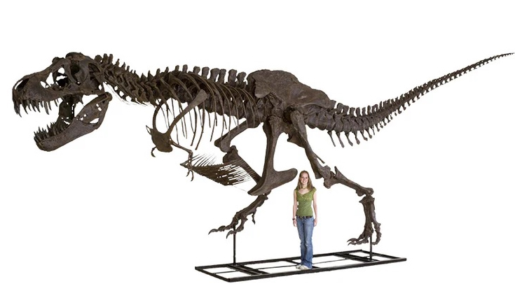
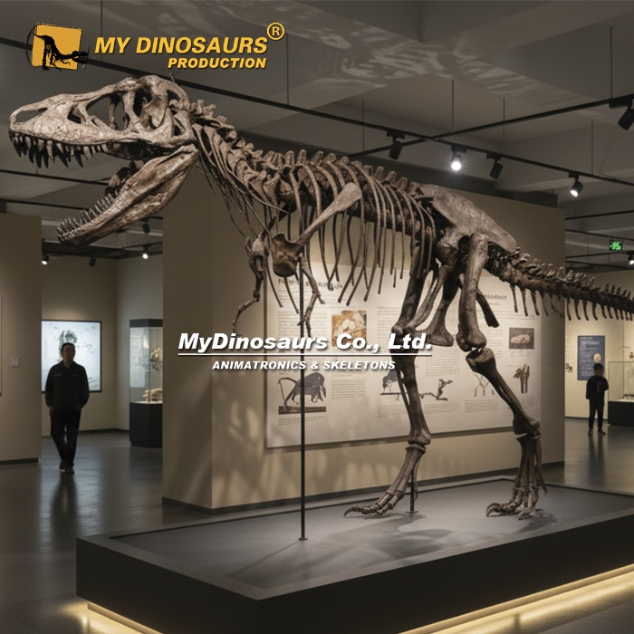
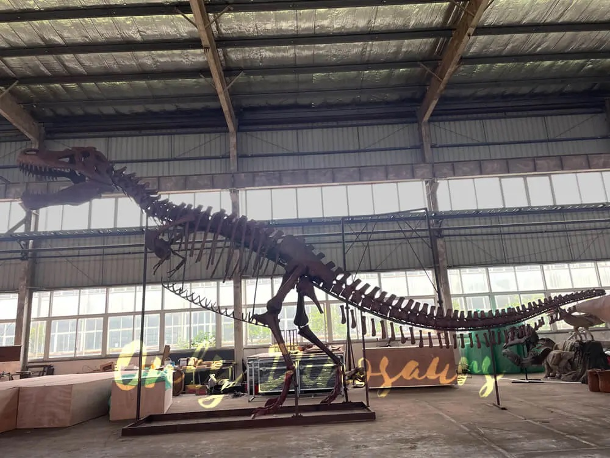
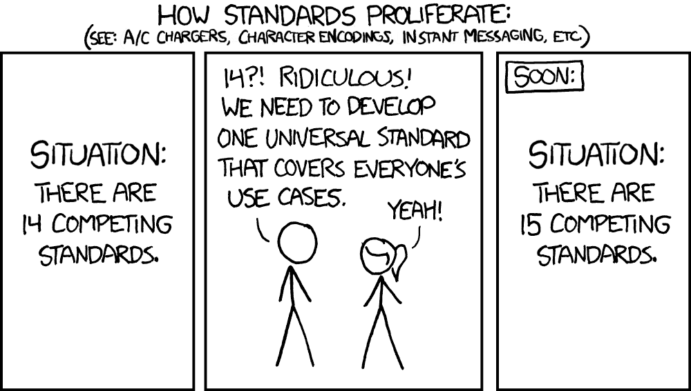
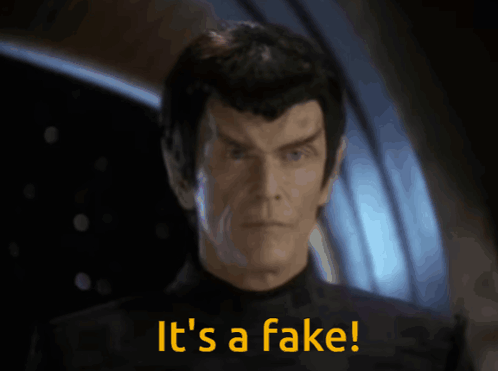

Imagine going to your favorite famous museum and finding that all the paintings had been replaced by posters of the paintings, with the actual art locked away. "See our [photo reproduction of the] Mona Lisa!" Would anything change[^lisanote]?

1. For taking a selfie to put on Insta, no, not really, a reproduction doesn't really affect the outcome. It could even help things if there are parallel lines for selfies with an array of duplicate Mona Lisas
2. For appreciating the details of the composition and coloring, it has to be a fairly high quality replacement
3. To appreciate the brushstrokes, an even higher fidelity reproduction is required
4. To look at chemical composition of the pigments to understand what plants and minerals were used, there is no substitute for the actual physical object

I recently toured the dinosaur exhibit at the Natural History Museum London. It's justifiably famous due to the museum's important place in the history of paleontology. However, many of the specimens on display are fake.[^fake] There's no trickery involved: in small lettering on the displays it lists that the dinosaur is a cast. In paleontology this is widely accepted. The actual fossils can be too heavy to mount without the risk of damage, and they can be hard to study in depth once mounted 15 feet in the air, so it's common practice to make a model of the fossil and mount that. Sometimes these are cast directly from the original specimen; sometimes they're cast from a previously made cast. Some museums are very direct about this -- the Field Museum, for example, with its famous "Sue" *T. rex* skeleton has the actual skull fossil on display and signs explaining that the one on the full skeleton is a re-creation (and not just a cast). Some museums now also have the recreations or models in a different color from the actual fossils so visitors can see the difference, or a placard showing which bones are real fossils versus reconstructions. The Natural History Museum London's dinoaur gallery seems to be largely an older exhibit (i.e., prominent signage indicating that dinosaurs, which are "reptiles", went extinct at the end of the Cretaceous but birds, which are a different group (?!), did not) did not make any major distinctions that I noticed. There is evidence that visitors prefer original specimens, not replicas (i.e., [van Gerven et al. 2018](https://doi.org/10.1080/21548455.2018.1497218), [Carsten Connor & Perin, 2020](https://doi.org/10.1080/21548455.2020.1831707)), but that's not the same as they learn nothing from a replica -- it's a widely accepted practice for very good reasons.

So, why doesn't every science museum have every dinosaur in life-sized replica form? Well, one thing is cost. A replica of the "Stan" *T. rex* [costs $150,000, plus shipping](https://fossilcatalog.com/products/stan-tyrannosaurus-rex®-skeleton-display-replica?pr_prod_strat=e5_desc&pr_rec_id=449ef3786&pr_rec_pid=7799363862572&pr_ref_pid=7799366909996&pr_seq=uniform) from the Black Hills Institute, but one can also get a full-sized replica (perhaps less accurate) from a [less well-known supplier for $50,000](https://www.mydinosaurs.com/product/life-size-t-rex-skeleton-replica/) and from [another as cheap as $11,500](https://onlydinosaurs.com/full-size-t-rex-skeleton-fossil/). Space also matters -- a herd of sauropods takes a lot more room, and brings in less money, than a second dino gift shop. 

[{fig-alt="Photo of a T. rex mounted with a person standing next to it"}](https://fossilcatalog.com/products/stan-tyrannosaurus-rex®-skeleton-display-replica?pr_prod_strat=e5_desc&pr_rec_id=449ef3786&pr_rec_pid=7799363862572&pr_ref_pid=7799366909996&pr_seq=uniform)

[{fig-alt="Photo of a T. rex in a museum gallery"}](https://www.mydinosaurs.com/product/life-size-t-rex-skeleton-replica/)

[{fig-alt="Photo of a T. rex skeleton in a warehouse"}](https://onlydinosaurs.com/full-size-t-rex-skeleton-fossil/)

It does still surprise me a bit, though: taking the pricey but accurate options, one could get full adult replicas of theropods *T. rex* ($150K), *Acrocanthosaurus* ($172K), *Allosaurus* ($86K), and *Struthiomimus* ($65K), plus a *Velociraptor* and *Protoceratops* locked together in death ($13K), plus full adult replicas of *Psittacosaurus* ($9K), *Triceratops* ($108K), *Stegosaurus* ($94K), and *Edmontosaurus* ($90K), for only $786,000 from the Black Hills Institute, and perhaps as little as a tenth of that from some of the less famous companies. Moreover, this all seems to predate the revolutions in 3D scanning (even your phone can generate 3D models, let alone all the tech available with lidar and similar) and 3D printing that could make it even more accessible. The Metropolitan Museum of Art, for example, has [high definition 3D scans of many pieces in its collection](https://www.thisiscolossal.com/2026/03/metropolitan-museum-of-art-3d-models-art-history/), and there are initiatives to share [thousands of scans from museums for printing](https://www.myminifactory.com/users/Scan%20The%20World?show=store&sortBy=popularity&page=1&files=files&price=free).

# Museum shards idea

TL;DR: when we bring a bus of schoolkids to a museum, we are often showing them a replica of actual fossils, not real ones, and this is accepted. What if we instead take a piece of the museum -- a shard -- and put it at their school? Still a replica, perhaps of lower quality, but enough for a 9 year old to see the scale of a dinosaur, look at healed punctures in its jaw, imagine what the teeth were used for, and so forth. And this needn't be limited to just dinosaurs: with permissions of their cultural descendants, one could include replicas of sculpture (Benin bronzes, Greek vases, Chinese funerary art, etc.), important paintings (done well, not just as posters) and more. Each year, shuffle the shards between schools so kids see new things.

There are lots of precedents for this. There's an [Art in Public Places Sculpture Program](https://www.dogwoodarts.com/sculptures) that leases sculptures a year at a time in public locations and rotates them around -- it costs [$3500-5000 per sculpture per year](https://www.dogwoodarts.com/_files/ugd/6aa64a_3167ca9f61b246d0b0945738e11b0763.pdf), which presumably includes compensation for the artists. The [Biology in a Box](https://www.easyasplay.org/biology-in-a-box-units) program sends curriculum-aligned activity boxes to hundreds of classrooms with specimens to investigate. Since 1940, Oberlin has let people in their community, including students in their dorms, [borrow original works of art](https://amam.oberlin.edu/art/collections/art-rental) (and some reproductions) for a small fee: "the collection features prints by Marc Chagall, Salvador Dalí, Honoré Daumier, Francisco Goya, Henri Matisse, Joan Miró, Pablo Picasso, and Henri de Toulouse-Lautrec, alongside works on paper and multiples by Mel Chin, Alex Katz, Ellsworth Kelly, Yasumasa Morimura, Faith Ringgold, and Lorna Simpson, among many others." There are probably many other examples: librarians are amazing, and so I'm sure there are lots of iniatives to share things with the community beyond books.

# Standards

A key to making this scale would be modular standards. There would need to be set ways to mount the pieces and dimensions, so that a school could just say "we have room for a medium wall pice and an outdoor mounted piece" and get objects of the right size and weight. Some potential ideas:

* **Large flat wall mount**: a single hook or similar capable of holding 20 pounds; the space extends 1.5 feet to the right and left of the hook, 1 foot above the hook, and 2 feet down from the hook (good for paintings, friezes, or similar)
* **Medium object case**: a case capable of holding a 1 foot cube of volume object: bust of Nefertiti, dinosaur egg replica, Marie Curie notebook replica
* **Medium outdoor support**: a 3 foot square of concrete, with 3/8" threaded stainless rod or bolts in each corner inset 4 inches from each face: a modern sculpture, a base for a small dinosaur mount, a demonstration bog in a large pot

To actually develop standards, it would make sense for a small working group of a couple of people who work in facilities at schools, some teachers, some parents/guardians, some kids, museum curators,  museum education specialists, and librarians to hammer out a small set of them, taking into account factors like cost, potential sizes of the objects to loan, and what protections might be prudent (how worried should we be about kids trying to climb something, protecting framed art from errant water guns during senior prank week, etc.). There should also be a standard for how information is included: is there a standard 5" by 8" placard with each object, should it have Braille, should it have a QR code, etc.? Publish some basic standards, make an opt-in database for schools listing what shard stands they have, and have a way for museums and other providers to list available shards. There could even be a market as companies like Carolina Biological Supply, PNSO, and others start creating realistic objects that can fit (even Home Depot could get into it, given its successes with relatively affordable but large ["Skelly"](https://abcnews.com/GMA/Living/home-depots-skelly-returns-upgrades-halfway-halloween-collection/story?id=131872594) and friends, though it might want to add some more accuracy first). There are lots of examples of standards leading to a thriving ecosystem: [Markdown](https://www.anildash.com/2026/01/09/how-markdown-took-over-the-world/), [Little Free Library](https://littlefreelibrary.org), [Certified Wildlife Habitats](https://www.nwf.org/Native-Plant-Habitats/Create-and-Certify), [T-Trak](https://nrail.org/T-TRAK-History), and more. 

# Benefits

* Persistent exposure to new information: every year the kids get a bunch of new objects to look at and start thinking about, but they are then there for the entire year. This gives the students a chance to, at some point, really examine the object and consider it. It also gives teachers a chance to include it in their lessons for that year.
* Connection: when they go to a museum, they can see the original object their shard was based on. "Oh, wow, the actual Archaeopteryx skeleton! In third grade we called ours 'Archie'." Museums can be large and intimidating at first -- this gives students a familiar face.
* Museum and research outreach: "scientists at our museum have discovered a new sabertoothed cat!" -- great, print 20 high-quality replicas of its skull and send them out as shards to schools in your state. Thousands of kids learn about the natural history in their state and might go to the museum to learn more. Same if the museum acquires a Georgia O'Keeffe painting: send out quality replica shards, and have students come to the museum to see the original and compare it with related works in the gallery. Researchers on NSF projects can include the creation of shards as part of their outreach plan.
* Beauty: all the shards will be educationally important and many will be simply beautiful. That's a good and valuable thing in its own right.
* More than just schools: while schools would be the primary audience, this could extend to anywhere with space and foot traffic. Empty store on a street: fill its windows with a few museum shards so it functions as a popup museum. Airports already often have rotating or fixed exhibits (I sometimes choose Chicago as a layover just so I can see the dinosaur): this gives them an easier way to get fresh objects. Maybe for-profit companies could kick in some money to help support the museum shards program overall.

# Risks

* Cost: there will be a cost to making the shard stands, especially larger outdoor ones. But it's on the same order as a square of a sidewalk. Moving pieces will also have a cost, but a lot of the moves would be local.
* Damage: the world is a dangerous place: minivans might bump into an outdoor sculpture, the clumsy physics teacher might trip and pour their coffee on the painting, etc. Some of the shards could be put in relatively protected places (a small statue goes in the same case that holds the "Geography Bee Champions of Springfield County 1997" trophy), but some will be out and risk damage. Try to minimize it, but also -- these are reproductions. They have a cost, but they are also not going to last forever. If we imagine that a shard is expected to have a life of twenty years before it'll be retired, a 2% chance of destruction per year is not an unreasonable amount of risk to take: 2/3 of them will still be perfectly fine after twenty years. 
* Censorship: Schools are working amid increasing constraints on allowable content: "All are welcome" is now a [banned sign in some parts of Michigan](https://www.washingtonpost.com/education/2026/07/14/teachers-this-michigan-district-can-only-post-these-32-phrases-bulletin-boards/), for example. Schools have experts trained in identifying appropriate content for students and following guidelines: librarians. Adding more work for them is never a good thing, but identifying a half dozen allowable objects from shards teachers request should be even less work than identifying the same number of books (less content to parse). They can then make a call as to whether the outdoor "properties of light" sculpture that includes a prism carries an unacceptably high risk of rainbows for it to be allowed by the local school board. And honestly, most shards will have almost no risk of pushback, perhaps with the exception of sculptures or paintings that show some nudity.

# Next steps

* Create a working group of relevant experts (see above) to establish some standards
* Stand up a website with the standards and, later, schools and museum shard providers
* Build the shard stands (which could be as simple as clearing off some space in the dusty trophy case and put some hooks on the wall)
* Start getting museum shards: buy available replicas, get donations from museums, etc.

I personally could do this, but I have lots of partially done initiatives, and I worry about rushing off to do this, getting it launched, and then finding a new shiny thing. So instead, I'm just sending this off into the ether for now to see if someone falls in love with it and wants to run with it. Maybe for your [NSF CAREER](https://www.nsf.gov/funding/opportunities/career-faculty-early-career-development-program) grant? Or an outreach project in your new museum curator job? Or your professional society to sponsor as a working group? Reach out to me (omeara.brian@gmail.com) if you think I could be of help, but also feel free to just go for it completely on your own. My only main suggestion is that if you do launch this, make sure to check for published standards and try to work with them -- I've seen far too many projects that fall into the XKCD standards trap.

[{fig-alt="Three panel cartoon. How standards proliferate. Situation: there are 14 competing standards. Person 1: 14?! Ridiculous, We need to develop one universal standard that covers everyone's use cases. Person 2: Yeah! Final panel: Soon: Situation, there are 15 competing standards"}](https://xkcd.com/927/)

# References

Carsten Conner, L. D., & Perin, S. M. (2020). Learning from the real versus the replicated: a comparative study. International Journal of Science Education, Part B, 10(3), 266–276. <https://doi.org/10.1080/21548455.2020.1831707>

van Gerven, D., Land-Zandstra, A., & Damsma, W. (2018). Authenticity matters: Children look beyond appearances in their appreciation of museum objects. International Journal of Science Education, Part B, 8(4), 325–339. <https://doi.org/10.1080/21548455.2018.1497218>

# Footnotes

[^lisanote]: You thought I was going to make either a Magritte *Ceci n'est pas une pipe* or a Ship of Theseus comment here. But I didn't!
[^fake]: [{fig-alt="Picture of a Romulan senator holding up a data rod with the caption 'It is a fake'"}](https://memory-alpha.fandom.com/wiki/In_the_Pale_Moonlight_(episode)#Act_Four)

___

To subscribe, go to <https://brianomeara.info/blog.xml> in an RSS reader.
